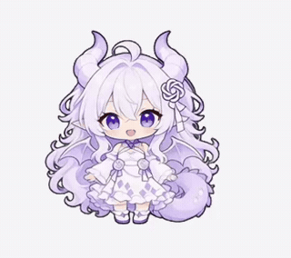
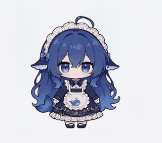

# AgentMusume

**Turn your AI agents’ work into a little desktop theater.**

AgentMusume is a Windows desktop companion app that reacts to AI agent sessions. Its three characters can follow local sessions from ChatGPT/Codex, Claude Code and DeepSeek Harness, responding to thinking, tool use, requests for confirmation and turn completion. Character interactions also reflect subtask handoffs, result delivery and completed collaborative turns, making agent activity and coordination visible on your desktop.

[Download Windows x64 installer](https://github.com/zollnor/Agent-Musume/releases/download/v0.1.2/Agent-Musume-Setup-0.1.2.exe) · [Releases](https://github.com/zollnor/Agent-Musume/releases) · [简体中文](README.md)

| Claude lady | Dragon girl | Blue whale girl |
| :---: | :---: | :---: |
|  |  |  |
| Review complete: a reserved thumbs-up | A hearty laugh | A maid dance |

## Three agent interactions

| Assign a task | Return the results | Celebrate together |
| :---: | :---: | :---: |
|  |  |  |
| Whale → Claude | Dragon → Whale | Claude × Dragon |

The GIFs show built-in animations and in-app interaction demos; they are not recordings of live model runs. The celebration marks a completed collaborative turn, not the success of a long-running goal.

## Install and try

Windows x64 only; developed and tested on Windows 11. Download `Agent-Musume-Setup-0.1.2.exe` from the Release, rather than the source-code archives. The installer is 355,398,828 bytes (about 355 MB / 339 MiB) and includes its runtime. You do not need Node.js, administrator rights or an API key to use the installer.

The installer is unsigned. Check the Release source and, if needed, compare its SHA-256 against `SHA256SUMS.txt` before deciding whether to run it.

After launch, three pets appear near the bottom-right corner. Right-click a pet to open settings. The tray menu also lets you demonstrate interactions without an AI tool running. Start with Windows is off by default. Uninstall through Windows Settings; configuration remains in `%APPDATA%\Agent-Musume`.

Version 0.1.2 improves cross-harness handoff detection for new CLI tasks, Herdr prompts and keys, terminal text delivery and Codex queued messages. An optional handoff skill covers other dispatch paths. See [release validation](docs/release-validation-v0.1.2.md). Installation, upgrade and uninstallation on a separate clean Windows machine have not been verified in this release session.

## What reacts to what

- Sources: local ChatGPT desktop, Codex CLI, Claude Code and DeepSeek Harness records.
- States: thinking, running tools, processing results, waiting for input, turn completion and errors.
- Interaction: confirmed subagent and cross-harness handoffs, result delivery, completion and comfort after failure; occasional idle chats.
- Everyday actions: click reactions, dragging, throwing, movement, pause and a 30-minute quiet mode.

The pets display agent activity; your existing agent tools execute the AI tasks. A completed animation means a turn has ended, not that a long-running goal has succeeded. Live interaction requires compatible local records and the correct source/helper assignments. Remote, browser-only, WSL and cloud sessions are not covered. Internal log formats may change with tool updates; multi-monitor and mixed-DPI behavior has not been fully tested.

## Cross-harness handoffs

Local ChatGPT desktop, Codex CLI, Claude Code and DeepSeek Harness share a handoff event interface covering all 12 directed combinations. Automatic detection follows parent processes for newly launched CLI tasks, including background launchers, and supports dispatch to existing agents through Herdr `agent prompt` / `send-keys`, WezTerm `cli send-text`, and `codex queue --thread`. These paths use process ancestry plus the receiving agent's status or session turn; two tools being busy at the same time does not establish a handoff. Herdr slash commands, permission approvals and typing that does not start a turn are excluded.

For other already-open sessions, choose **接入跨工具联动…** in the tray menu to install the optional `agent-musume-handoff` skill, or run `node src/handoff.mjs install` from source. Start a new agent session or reload its skills after installation. The skill reports only task lifecycle metadata and does not call a model or change agent permissions. At least two visible, collaboration-enabled pets with matching source/helper settings are required. Very short tasks may be missed by process observation; the explicit event bridge records dispatch and return directly. See the [handoff guide](docs/cross-harness-handoffs.md) and the [Chinese instructions](README.md#跨工具派任务).

## Privacy

The application runs locally without calling a model or uploading session content. It reads lifecycle, tool-type, process and timing metadata from local agent records to determine reactions. For new candidate processes, it examines command lines locally to classify task launches and supported relay commands; Herdr prompt text is checked only for a leading slash. It does not retain command lines, prompts, model replies or tool output, and does not inspect process environments or memory. Herdr pane queries retain only agent type, state and a session identifier used transiently for matching. The optional skill writes only its dedicated skill directory. Its control server binds to `127.0.0.1`, and write requests require a capability token. Do not share the entire configuration directory or raw agent-session logs.

See the [Chinese README](README.md#隐私) for the exact local directories and configuration overrides.

## Run from source

Node.js 22.15 or newer is required. In the project directory:

```powershell
npm ci
npm start
```

`npm ci` downloads the pinned Electron runtime. `npm test` prepares the generated runtime files and runs the automated checks; `npm run package` creates a Windows NSIS installer under `release/`. See [CONTRIBUTING.md](CONTRIBUTING.md).

## Credits and licenses

Based on [PC2005-cloud/dsh-pet](https://github.com/PC2005-cloud/dsh-pet). Code: [MIT](LICENSE). Character art, animation and derived previews: [CC BY-NC-SA 4.0](https://creativecommons.org/licenses/by-nc-sa/4.0/), non-commercial and share-alike; the whole application is not licensed for unrestricted commercial use. The bundled font is SIL OFL 1.1. See [NOTICE.md](NOTICE.md).

The whale character is adapted from designs by [上善无形](https://space.bilibili.com/4456176) and [ZipZipPipe](https://space.bilibili.com/4168597); the Claude and dragon characters are based on ZipZipPipe’s designs. The dragon also references a pet by [legeling](https://codexpet.top/pets/gpt-dragon-girl--legeling). Claude and dragon animation, paired takes and the new whale side-walk are AI-generated using MiniMax H3. The previews are crops/composites of the bundled animation.

Unofficial fan project. Not affiliated with or endorsed by OpenAI, Anthropic or DeepSeek. Trademarks belong to their respective owners.
